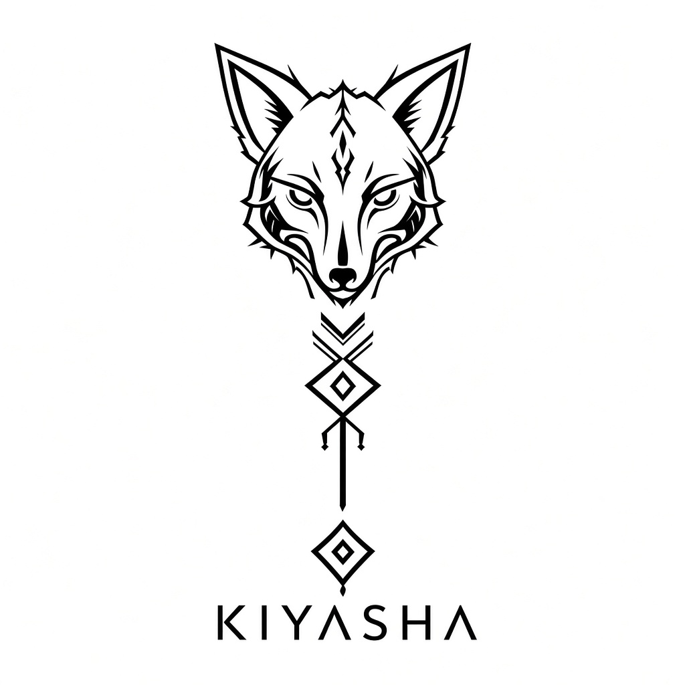

<p align="center">
  
</p>

<br>

# 🦊 Kiyasha's little den
> *„Pssst... du hast tatsächlich in meinen Fuchsbau gefunden.“* 🌙

Welcome to my little corner of GitHub.  
I'm **Kiyasha**, a creative builder, author, gamer and worldbuilder who enjoys turning ideas into something you can actually explore.

---

## 🦊 About the Fox

```text
╭──────────────────────────────╮
│  🦊 Kiyasha                  │
│                              │
│  ✦ Builder                   │
│  ✦ Author                    │
│  ✦ Gamer                     │
│  ✦ Worldbuilder              │
│  ✦ Fox enthusiast            │
│                              │
│  Status: Exploring... 🌙     │
╰──────────────────────────────╯
```

I like creating things where **technology meets imagination**.

Minecraft worlds, fantasy characters, interactive websites, stories, servers and strange little ideas that somehow turn into much bigger projects.

---

## 🌙 What does the fox like?

<details>
<summary>🦊 Open the fox's thoughts</summary>

### 👀 Interests

- 🦊 Kitsune & foxes
- 🎮 Gaming
- 🏰 Minecraft building
- 🌍 Worldbuilding
- ✍️ Writing
- 🌑 Dark Fantasy
- ✨ Mythology
- 💻 HTML & web projects
- 🐾 Animals
- 🗺️ Interactive worlds

</details>

<details>
<summary>🌱 What am I learning?</summary>

I'm constantly experimenting with:

- 💻 HTML / CSS / JavaScript
- ⚙️ Minecraft server technology
- 🧩 Plugins & systems
- 🗺️ Interactive maps
- 🎨 Creative world design
- 🔧 Random things that somehow become projects

</details>

---

## 🎮 Current adventures

```text
╔══════════════════════════════════════╗
║             Kiyasha.exe              ║
╠══════════════════════════════════════╣
║ 🦊 Status       : Exploring          ║
║ 🧱 Building     : ████████░░ 80%     ║
║ 💻 Coding       : ██████░░░░ 60%     ║
║ ✍️ Writing      : ███████░░░ 70%     ║
║ ☕ Coffee       : ██████████ 100%    ║
║ 🦊 Fox Energy   : ∞                  ║
╚══════════════════════════════════════╝
```

---

## 💞 Looking for adventurers

I'm always interested in creative projects involving:

**🎮 Minecraft** · **🦊 Fantasy** · **🌍 Worldbuilding** · **💻 Web Projects** · **✍️ Stories** · **🎨 Building**

Maybe our paths cross somewhere between the forest and the code. 🌲

---

## 🐾 Tiny Fox Game

**You found a wild fox!**

```text
        /\   /\
       //\\_//\\
       \_     _/
        / • • \
       (   ^   )
        \  -  /
         \___/

🦊 The fox is watching you...
```

Choose your action:

<details>
<summary>🍖 Give the fox food</summary>

The fox accepts your offering.

**Relationship +1 ❤️**

</details>

<details>
<summary>🌲 Follow the fox</summary>

You follow it deep into the forest...

**A hidden project has been discovered. 👀**

</details>

<details>
<summary>🏃 Run away</summary>

The fox looks confused.

**The fox remembers this.**

</details>

---

## 📫 Find me

You can find me here on GitHub and through my various gaming, building and creative projects.

### 😄 Pronouns

**She / Her**

---

## ⚡ Random Fox Fact

I like foxes **way too much**.

If a project can somehow contain a fox...

**it probably will.** 🦊

---

### 🌙 Before you leave...

```text
        🦊
       /|\
      / | \
     /  |  \
    ~~~~~~~~~
    The fox remembers
    every visitor.
```

> *„Every world starts with a small idea.“*

🦊 **Thanks for visiting my den.**
